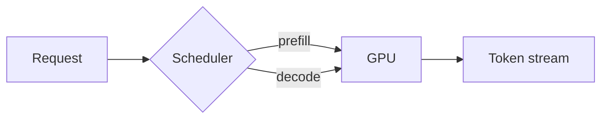

This is placeholder text. It exists so you can see every feature of the new site in one place. Delete it, or rewrite it as the real first post.

Inference is where models meet money: every token has a latency and a price.[^1] The interesting problems live between the model weights and the user.

## Code

Titles, line highlighting and diffs come from Shiki. The copy button is added client-side.

```python title="tool_call_parser.py" {3-4}
import json

def parse_tool_call(text: str) -> dict | None:
    start, end = text.find("{"), text.rfind("}")
    return json.loads(text[start : end + 1]) if start != -1 else None
```

```ts title="diff.ts"
const kv = new Map();
const kv = new PagedKVCache({ blockSize: 16 }); // [!code ++]
```

## Math

Inline: the attention score is $\mathrm{softmax}(QK^\top/\sqrt{d_k})$. Block:

$$
\mathrm{Attn}(Q,K,V)=\mathrm{softmax}\!\left(\frac{QK^\top}{\sqrt{d_k}}\right)V
$$

## Diagram



## Chart

<Chart
  type="bar"
  title="Decode throughput (placeholder numbers)"
  yLabel="tokens / s"
  labels={["Engine A", "Engine B", "Engine C"]}
  datasets={[{ label: "batch 1", data: [92, 118, 131] }, { label: "batch 32", data: [1410, 2260, 2570] }]}
  caption="Made-up data to demonstrate the component."
/>

<Benchmark
  caption="Placeholder numbers."
  columns={[
    { key: "engine", label: "Engine" },
    { key: "ttft", label: "TTFT", unit: "ms", digits: 1, better: "lower" },
    { key: "tps", label: "Throughput", unit: "tok/s", digits: 0, better: "higher" },
  ]}
  rows={[
    { engine: "Engine A", ttft: 84.2, tps: 1410 },
    { engine: "Engine B", ttft: 61.9, tps: 2260 },
    { engine: "Engine C", ttft: 72.5, tps: 2570 },
  ]}
/>

<Callout type="finding" title="Finding">
Constrained decoding costs far less than people assume once the grammar mask is precomputed.
</Callout>

<Callout type="note">A note, for context.</Callout>
<Callout type="warn">A warning, for sharp edges.</Callout>

<Aside>A sidenote: in the margin on wide screens, inline on narrow ones.</Aside>

<Figure src="/img/projects/osmpy.png" alt="OpenStreetMap rendering" caption="Figure with a caption." />

[^1]: A footnote, rendered at the bottom with a back-link.
