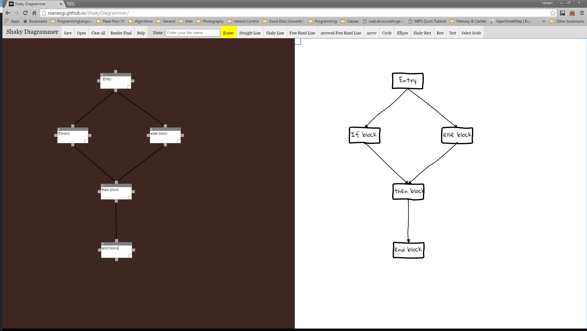

[Github](https://github.com/ssarangi/shakyDiagrammer)
[Demo](https://ssarangi.github.io/ShakyDiagrammer/)

## Shaky Diagrammer:

Making diagrams are hard especially for non-artists. Having said this I was very interested in this particular tool (https://moe-js.googlecode.com/git/talks/jsconfeu2012/tools/shaky/deploy/shaky.html)
I used this tool for some of my diagrams and it just looks fabulous. However, working with text was a bit painful. So I decided to write something which is similar (and I actually ripped the shaky part)
out from the author's code. However, I wanted to reuse some of my older code and also experiment with javascript canvas'es a bit more.

## Screenshot

